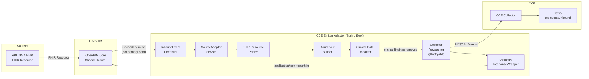
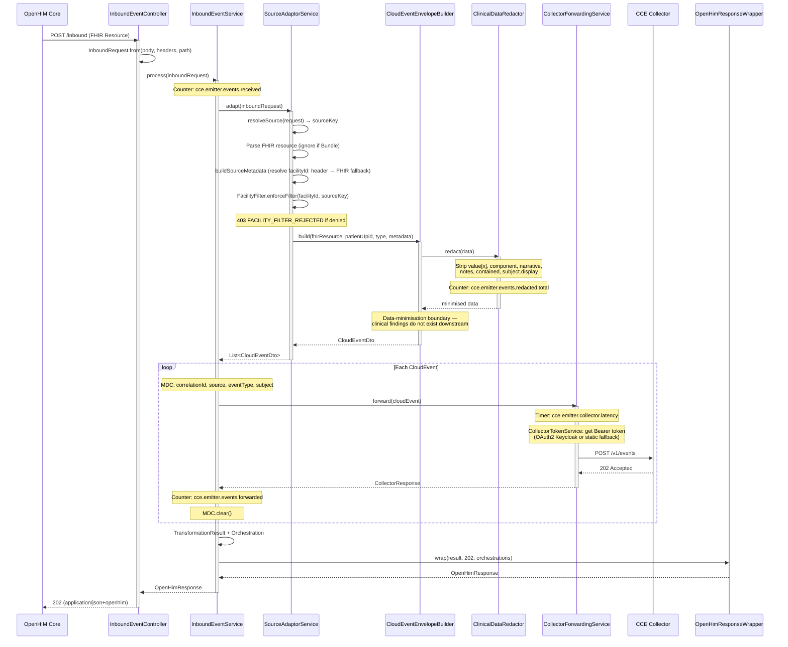
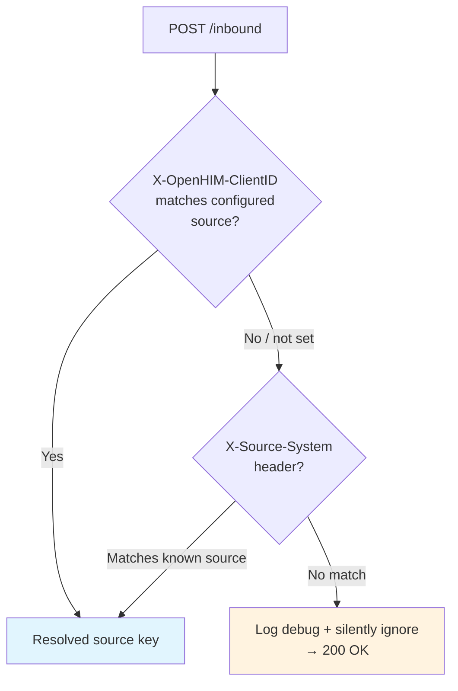
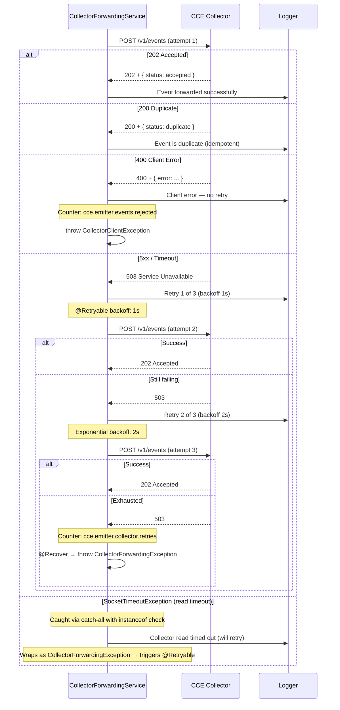
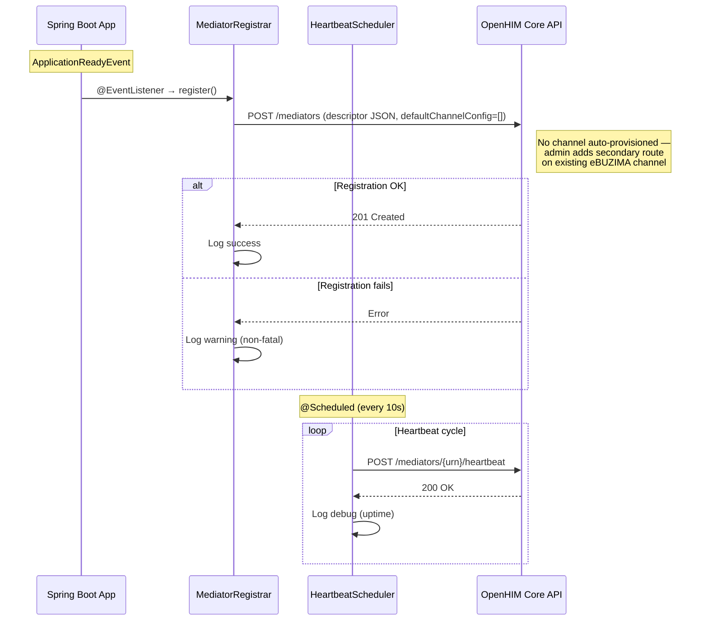
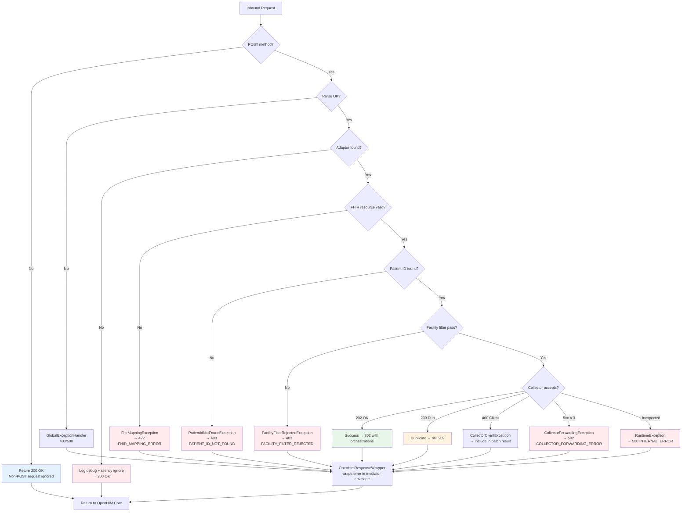
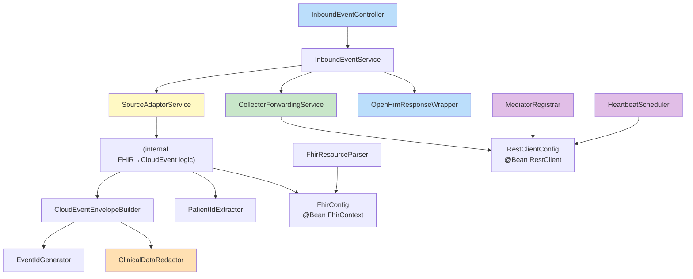
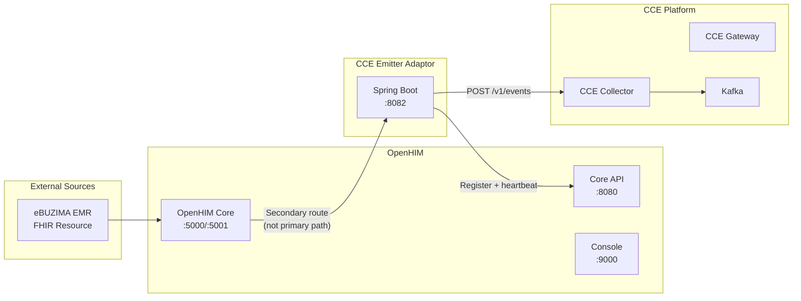
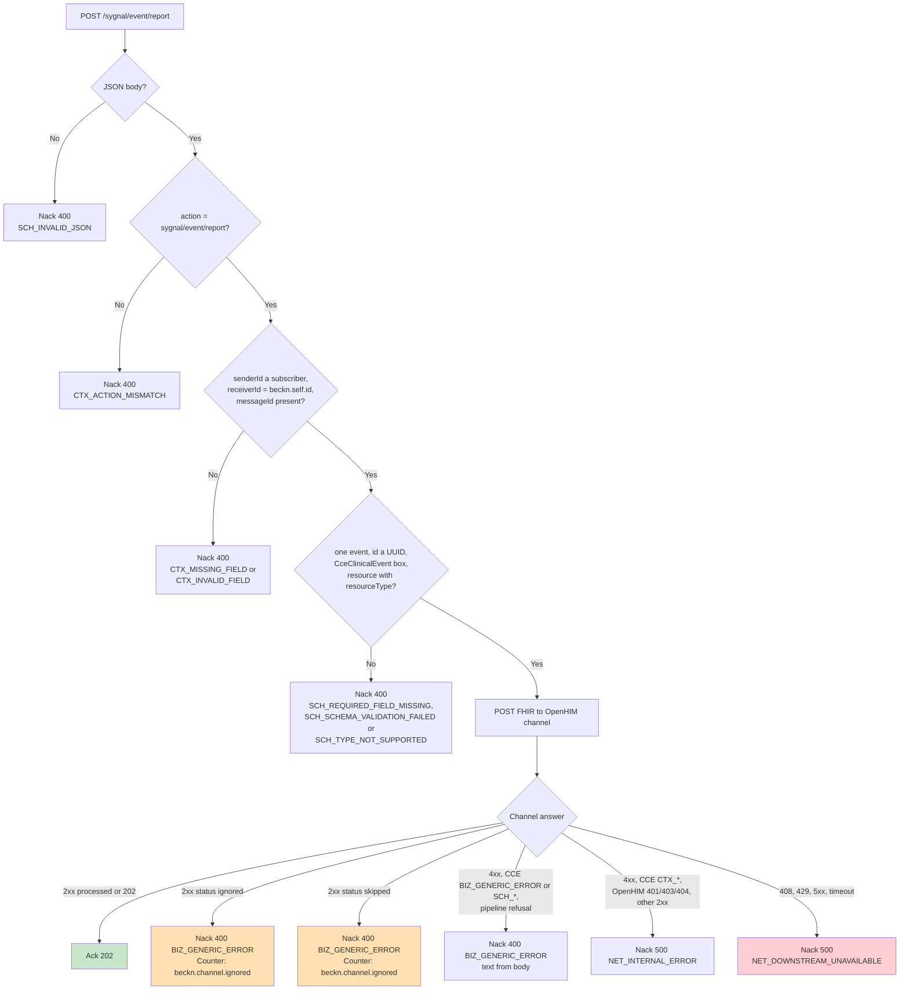
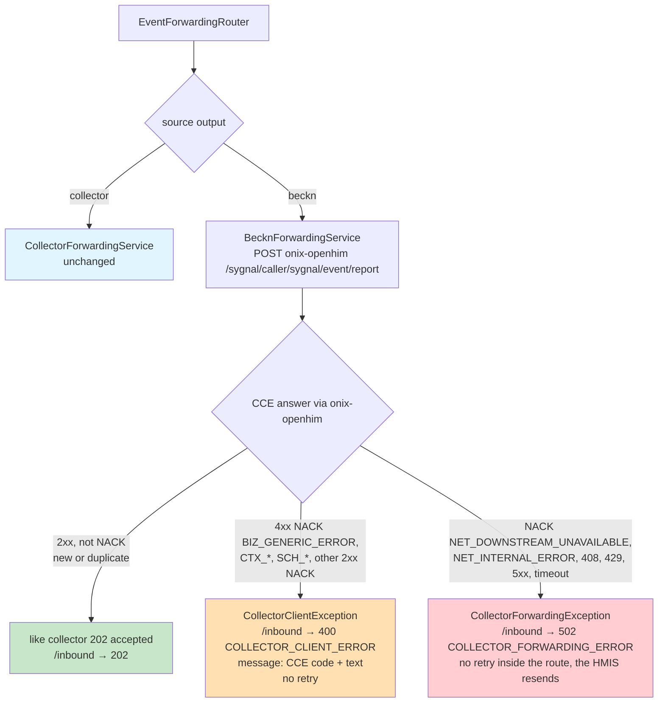

# CCE Emitter Adaptor — Flow Diagrams

All diagrams use Mermaid notation.

## 1. End-to-End Event Flow



## 2. Request Processing Sequence



## 3. Adaptor Selection Flow



## 4. Collector Forwarding with Retry



## 5. OpenHIM Registration & Heartbeat Lifecycle



## 6. Error Handling Flow



## 7. Component Dependency Graph



## 8. Deployment Topology



## 9. Sygnal Flows (Proposal)

> **Status:** Built on branch `sygnal-actions`, on by default (`beckn.enabled=true`; set `OPENHIM_EMITTER_BECKN_ENABLED=false` to turn it off). Full design: [Beckn Integration](beckn-integration.md). The flows in §1–§8 are unchanged: with `beckn.enabled=false` and every source on `output: collector`, events go from OpenHIM to the CCE Collector as today.

### 9.1 Sygnal Inbound → Channel → Pipeline → Sygnal Output

Both hops use the action `sygnal/event/report`. There are no callbacks: every answer comes back in the same HTTP call, and the HMIS gets its answer only after CCE has answered.

```mermaid
sequenceDiagram
    participant HM as OpenMRS emitter<br/>→ onix-openmrs caller
    participant OR as onix-openhim<br/>receiver
    participant BW as SygnalEventReportController<br/>+ BecknInboundService
    participant OHC as OpenHIM Core<br/>(channel /cce-beckn)
    participant IN as InboundEventController<br/>+ InboundEventService
    participant SA as SourceAdaptorService<br/>+ CloudEventEnvelopeBuilder
    participant BF as BecknForwardingService
    participant OC as onix-openhim<br/>caller
    participant CCE as onix-cce receiver<br/>→ cce-beckn-service :8075<br/>→ Collector

    HM->>OR: sygnal/event/report (signed by the HMIS)
    OR->>BW: POST /sygnal/event/report
    activate BW
    Note over BW: Counter: cce.emitter.beckn.received
    BW->>BW: action, senderId in subscribers, receiverId = beckn.self.id,<br/>messageId, exactly one event, id a UUID, CceClinicalEvent box
    BW->>BW: take events[0].eventAttributes.resource
    BW->>OHC: POST channel (Basic auth)<br/>X-Source-System, X-Source-Event-Id, X-Sygnal-Event-Id,<br/>X-Sygnal-Occurred-At, X-Correlation-Id
    activate OHC
    Note over BW: Timer: cce.emitter.beckn.channel.latency
    OHC->>IN: POST /inbound (primary route)<br/>+ X-OpenHIM-ClientID, X-OpenHIM-TransactionID
    activate IN
    IN->>SA: adapt(request)
    activate SA
    SA->>SA: resolveSource: X-OpenHIM-ClientID, then X-Source-System
    SA->>SA: parse FHIR, patient id, facility (from resource), filter
    SA->>SA: redact, build CloudEvent<br/>id = X-Sygnal-Event-Id, time = X-Sygnal-Occurred-At
    SA-->>IN: CloudEventDto
    deactivate SA
    IN->>IN: EventForwardingRouter: source output = beckn
    IN->>BF: forward(cloudEvent)
    activate BF
    BF->>BF: CceClinicalEventMapper: CloudEvent → box<br/>events[0].id = CloudEvent id (the HMIS's id)
    BF->>OC: POST /sygnal/caller/sygnal/event/report
    activate OC
    Note over BF: Timer: cce.emitter.beckn.onix.latency
    OC->>CCE: sygnal/event/report (signed by the HIE)<br/>to context.receiverUri + /sygnal/event/report
    CCE-->>OC: 202 ACK (up to ~17 s; new or duplicate)
    OC-->>BF: 202 ACK
    deactivate OC
    Note over BF: Counter: cce.emitter.beckn.cce.report.sent, result ack
    BF-->>IN: CollectorResponse (accepted)
    deactivate BF
    Note over IN: Counter: cce.emitter.events.forwarded
    IN-->>OHC: 202 (application/json+openhim)
    deactivate IN
    OHC-->>BW: 202 + ProcessedEventsResponse
    deactivate OHC
    Note over BW: Counter: cce.emitter.beckn.answered, result ack
    BW-->>OR: 202 ACK (request's messageId)
    deactivate BW
    OR-->>HM: 202 ACK
```

### 9.2 Sygnal Endpoint: Answer Mapping



### 9.3 Sygnal Output: Answer Mapping

The Sygnal output returns the same results to `InboundEventService` as the collector path.



### 9.4 No Callbacks

There is no `on_update` (or any other callback) on either hop. CCE's synchronous answer is passed back through `/inbound` and the OpenHIM channel to the HMIS in the same call. If the HIE times out first (`beckn.openhim-channel.timeout`, 25 s), the HMIS gets 500 `NET_DOWNSTREAM_UNAVAILABLE` and sends the event again. The resend carries the same event id, so CCE answers `Ack` for the duplicate.
