# CCE Emitter Adaptor — Flow Diagrams

All diagrams use Mermaid notation.

## 1. End-to-End Event Flow

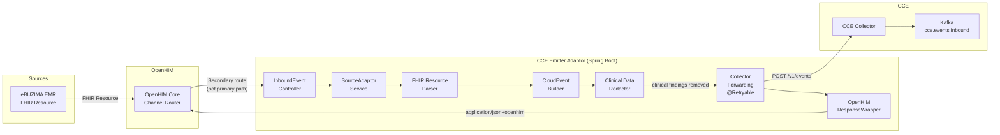

## 2. Request Processing Sequence

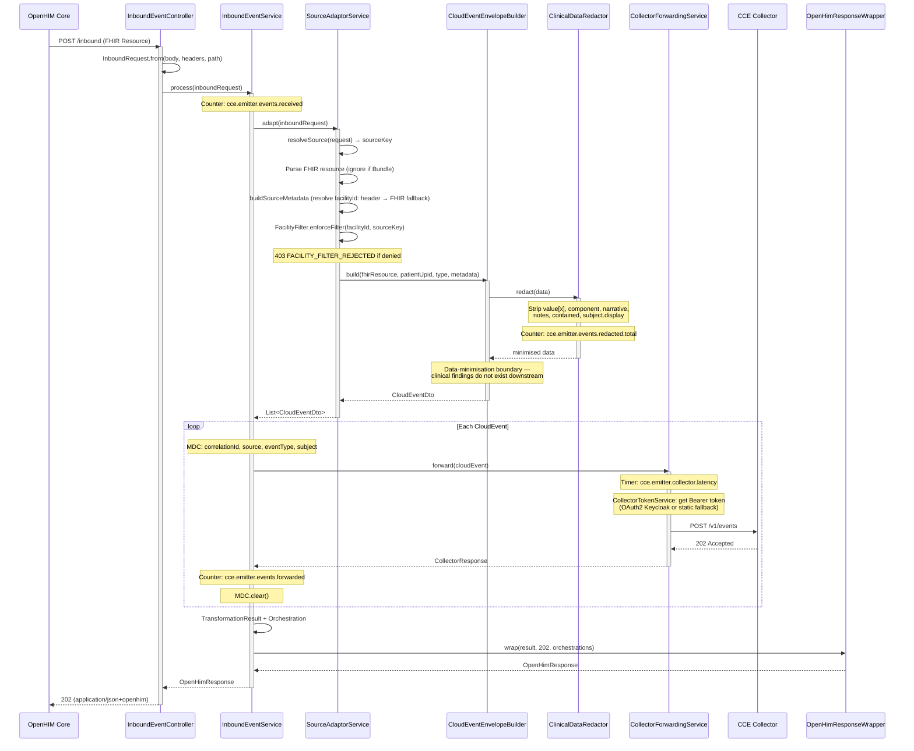

## 3. Adaptor Selection Flow

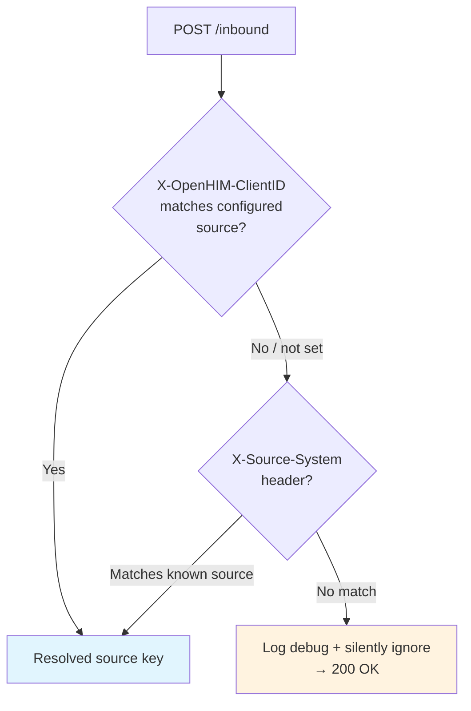

## 4. Collector Forwarding with Retry

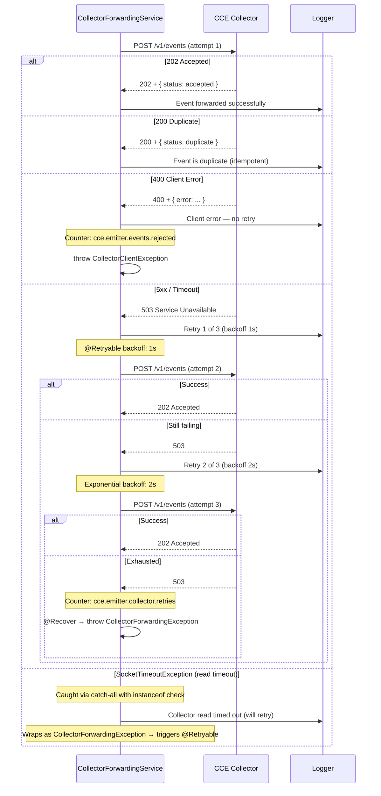

## 5. OpenHIM Registration & Heartbeat Lifecycle

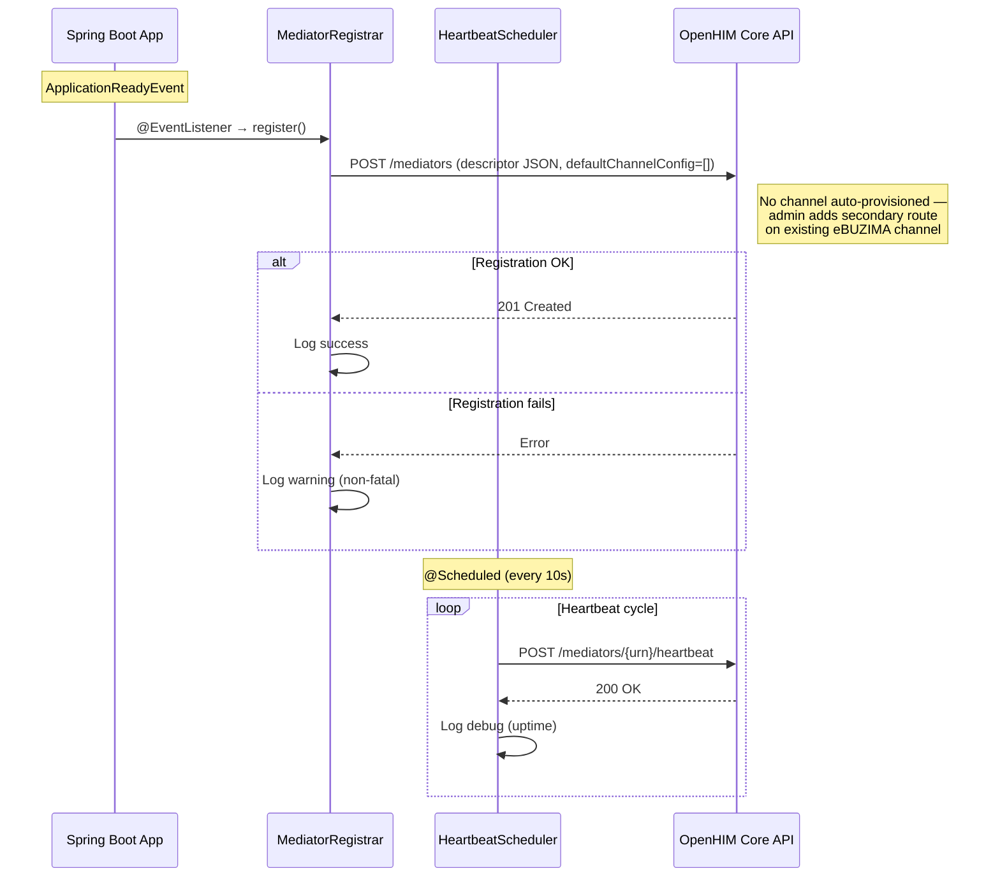

## 6. Error Handling Flow

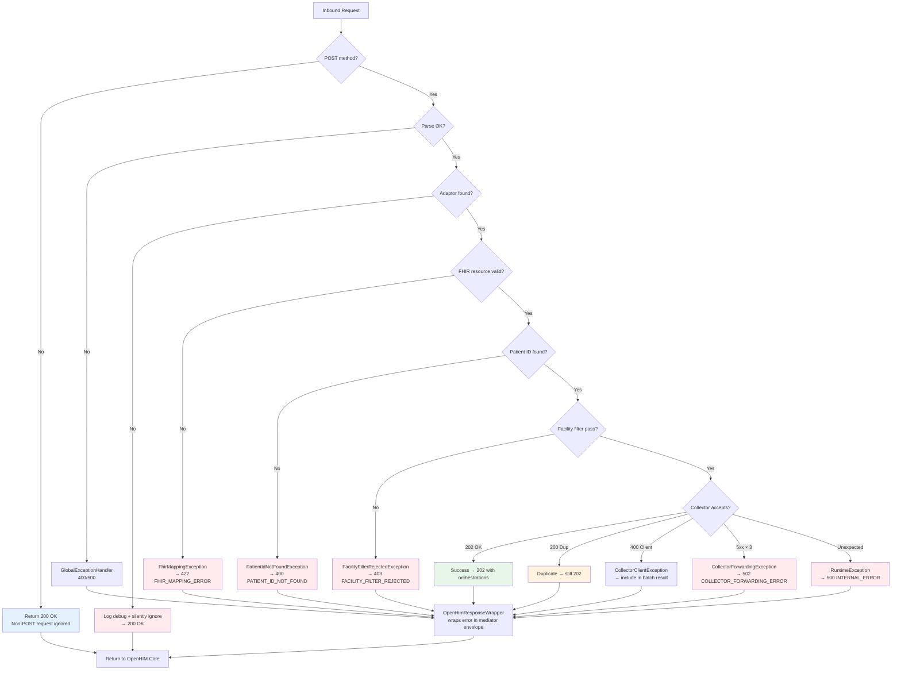

## 7. Component Dependency Graph

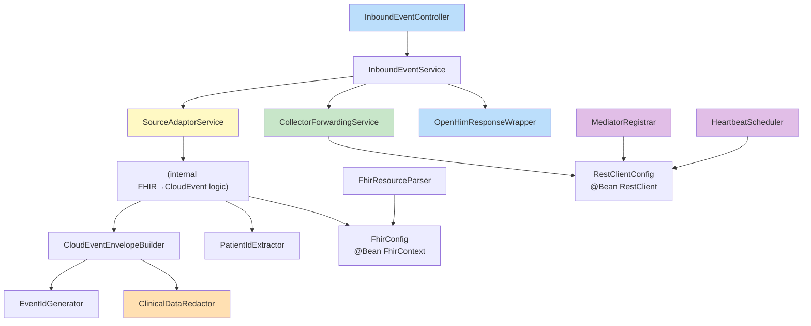

## 8. Deployment Topology

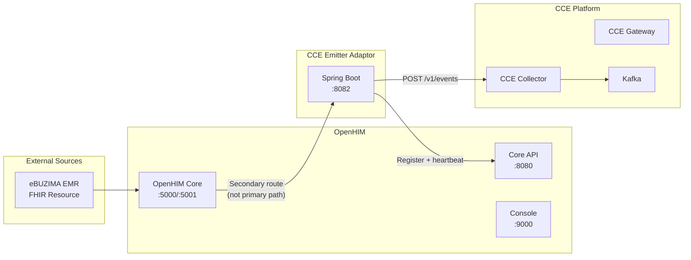

## 9. Beckn Flows (Proposal)

> **Status:** Built on branch `demo-beckn`, on by default (`beckn.enabled=true`; set `OPENHIM_EMITTER_BECKN_ENABLED=false` to turn it off). Full design: [Beckn Integration](beckn-integration.md). The flows in §1–§8 are unchanged: with `beckn.enabled=false` (default) and every source on `output: collector` (default), events go from OpenHIM to the CCE Collector as today.

### 9.1 Beckn Inbound → Channel → Pipeline → Beckn Output

All answers come back in the same HTTP call.

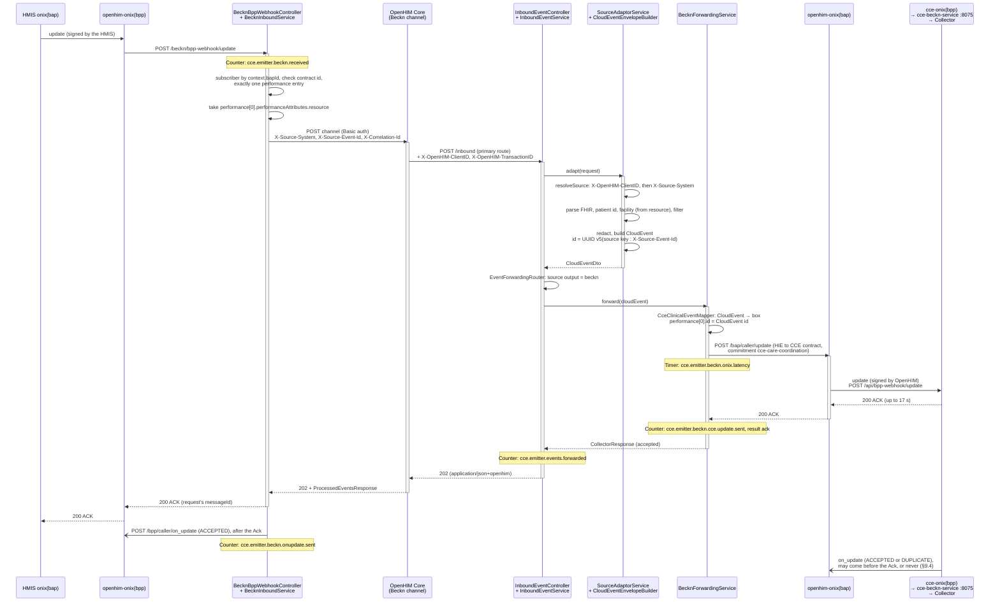

### 9.2 Unwrap Endpoint: Answer Mapping

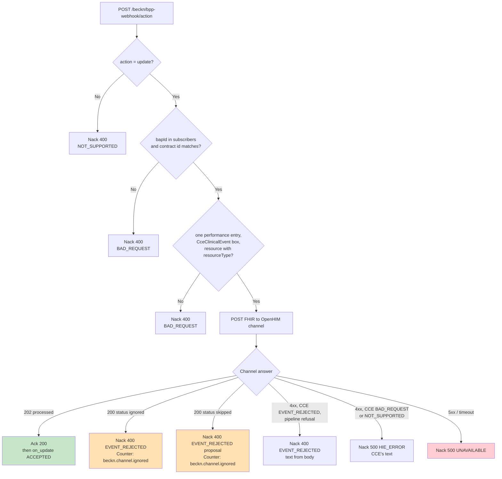

### 9.3 Beckn Output: Answer Mapping

The Beckn output returns the same results to `InboundEventService` as the collector path.

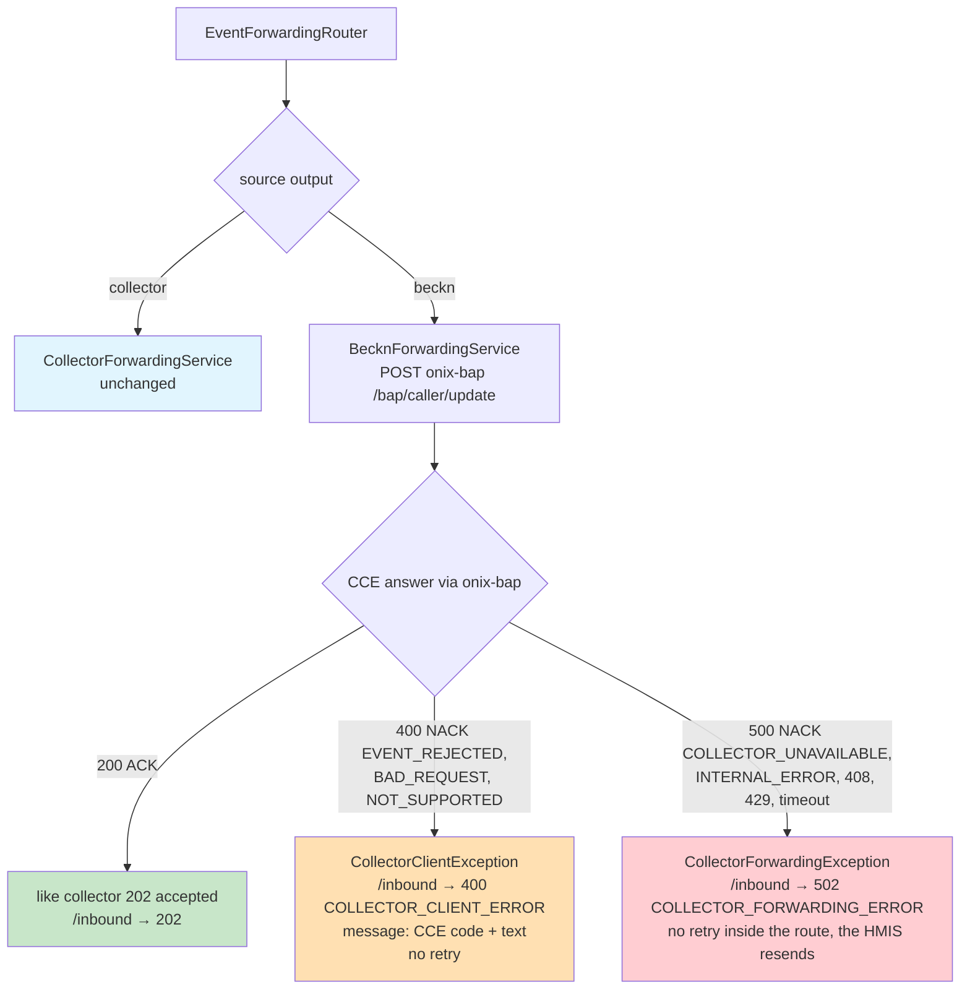

### 9.4 Callback from CCE

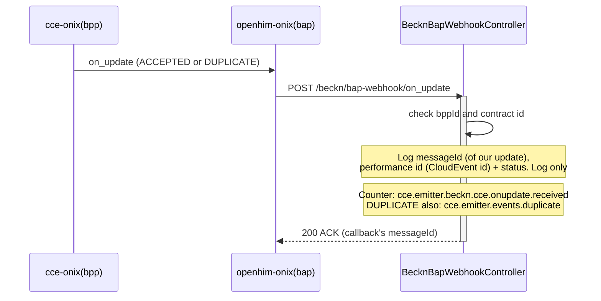

CCE sends `on_update` once. It may arrive before the `Ack` of the `update`, or not at all. It never changes what the HMIS was told.
